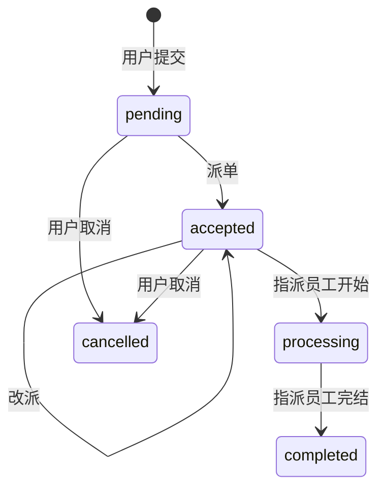

# 服务工单 API

工单用于安装（installation）、维修（repair）和安全检查（inspection）预约。响应使用统一 Result 包装。时间格式为 `yyyy-MM-dd HH:mm:ss`，使用应用本地时间。

## 用户接口

需普通用户 access token，账号必须有效；仅能访问自己的工单及操作日志。

| 方法 | 路径 | 说明 |
| --- | --- | --- |
| POST | `/api/v1/work-orders` | 提交服务预约 |
| GET | `/api/v1/work-orders` | 我的工单分页 |
| GET | `/api/v1/work-orders/{id}` | 详情及服务地址快照 |
| GET | `/api/v1/work-orders/{id}/logs` | 操作记录分页，按发生顺序排列 |
| PUT | `/api/v1/work-orders/{id}/cancel` | 取消待派单或已接单工单 |

创建请求：

```json
{
  "type":"repair",
  "title":"燃气灶维修",
  "description":"点火失败，请上门检查",
  "storeId":1,
  "addressId":10,
  "appointmentTime":"2026-11-01 10:00:00",
  "requestId":"service-20261101-001"
}
```

storeId 可选，填写时须为有效门店。addressId 必须属于当前用户。预约时间必须晚于当前时间；title 必填且最多 200 字，description 必填且最多 5000 字。requestId 为 1 至 64 位字母、数字、下划线或连字符，同一用户重复提交相同编号返回原工单，不重复生成日志。请求仍须通过参数验证。

创建时保存服务地址快照，手机号在数据库中保持加密。后续修改或删除地址不改变工单服务地址。工单编号使用 WO 前缀和 UUID，不依赖 Redis。

取消请求：`{"remark":"预约有变，取消服务"}`。remark 必填，最多 1000 字；重复取消返回已取消工单，不重复写日志。开始处理后不能由用户取消。

## 管理端接口

使用管理员类型令牌；自定义员工角色通过已有员工登录接口获得该类型令牌。

| 方法 | 路径 | 权限 | 说明 |
| --- | --- | --- | --- |
| GET | `/api/v1/admin/work-orders` | workorder:read | 全部工单分页 |
| GET | `/api/v1/admin/work-orders/{id}` | workorder:read | 详情 |
| GET | `/api/v1/admin/work-orders/{id}/logs` | workorder:read | 操作日志分页 |
| PUT | `/api/v1/admin/work-orders/{id}/assign` | workorder:assign | 派单或改派 |
| PUT | `/api/v1/admin/work-orders/{id}/start` | workorder:process | 指派员工开始处理 |
| PUT | `/api/v1/admin/work-orders/{id}/complete` | workorder:process | 指派员工提交处理结果并完结 |

workorder:read 为全部工单及服务地址的读取权限，应授予需要全局调度的人员。处理权限本身不授予全局查询权限。start/complete 还校验当前员工确为该工单指派员工、账号及门店有效且归属一致。

派单请求：

```json
{"storeId":1,"employeeId":7,"remark":"安排维修人员上门"}
```

门店、员工均须有效，员工必须属于该门店并已获得 workorder:process 权限。remark 必填，最多 800 字。仅 pending/accepted 可派单或改派，允许调度到另一有效门店。派单后进入 accepted。重复派给同一门店、同一员工不重复记录。

开始和完结请求均为 `{"remark":"处理说明或最终服务结果"}`，必填且最多 1000 字。重复开始处理不重复记录；完结重试须提交相同结果，不允许修改已完结工单。

## 查询与返回字段

工单列表支持 page（默认 1）、size（默认 20、上限 100）、status、type、keyword（匹配标题或工单号）、storeId、employeeId。sort 白名单为 createTime/updateTime/appointmentTime，order 为 asc/desc。用户列表始终附加本人条件，传入其他筛选项不会扩大可见范围。

日志接口支持 page、size。分页返回 list、total、page、size、pages。

工单返回 id、workOrderNo、userId、storeId、employeeId、title、description、type、status、address、appointmentTime、acceptedTime、startedTime、completedTime、result、createTime、updateTime。日志含 id、operatorId、operatorType（user/employee）、action、content、createTime；旧日志 operatorType 可为空。

## 状态和一致性



业务状态与工单日志在同一数据库事务中提交。组织事务锁和工单行锁串行化派单、处理与取消，避免并发覆盖。accepted/processing 工单关联的门店、员工和处理权限不可被组织管理接口变更为无效，需先改派、取消或完结。processing 工单须先完结，不能改派。工单和操作日志保留作为服务记录，不开放删除和任意状态修改接口。

数据库新增迁移 `V1.8__work_order_workflow.sql`，包含预约地址快照、员工指派、时间、完工结果、提交请求唯一索引及三项权限；内置 admin 角色自动获得权限，自定义角色需配置。旧工单新增字段为空，接口兼容展示；旧 pending/accepted 工单可派单，旧 processing 且无员工的异常记录需在上线前按实际业务补齐指派信息。

参数和业务状态冲突返回 HTTP 400，未登录返回 401，权限不足或非指派员工操作返回 403。本模块不产生支付单；收费服务和消息提醒可后续接入。

集成测试使用 H2 MySQL 兼容模式，覆盖完整流程、地址加密快照、归属、权限、改派、终态保护、日志幂等、并发提交和处理/取消竞争；生产 MySQL 迁移及并发验收尚需部署环境验证。
